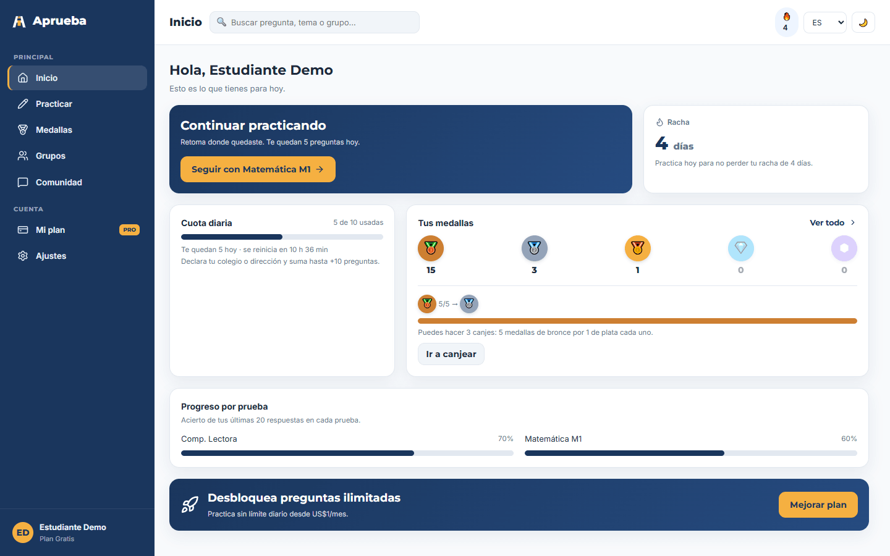
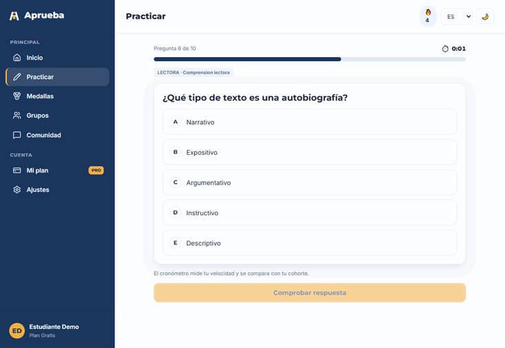
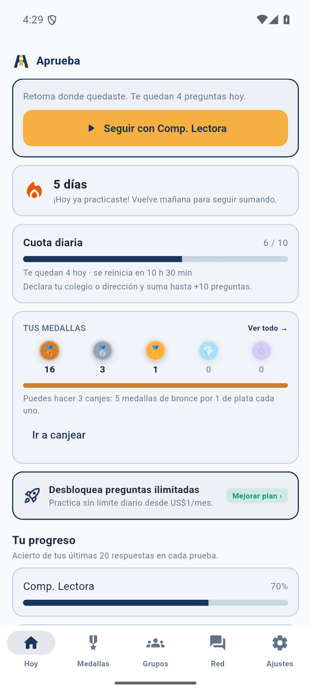

<p align="center">
  <picture>
    <source media="(prefers-color-scheme: dark)" srcset="docs/assets/logo-blanco.png">
    
  </picture>
</p>

<h1 align="center">Aprueba — Proyecto APT (Capstone PTY4614)</h1>

<p align="center">
  Plataforma móvil y web de preparación para la <b>PAES</b>, desarrollada como proyecto de
  título para la empresa <b>Alloxentric</b>.<br>
  Ingeniería en Informática, Duoc UC — Sede San Joaquín, semestre 2026-2.
</p>

<p align="center">
  
  
  
  
  
  
  
</p>

<p align="center">
  <a href="https://aprueba-student-web.vercel.app">Sitio web</a> ·
  <a href="docs/documentacion-api.md">Documentación de la API</a> ·
  <a href="docs/uml">Diagramas</a> ·
  <a href="docs/manual-tecnico.md">Manual técnico</a> ·
  <a href="docs/scrum">Scrum</a>
</p>

## Vistas

<p align="center">
  <br>
  <sub><b>Sitio web</b> — Inicio: continuar practicando, racha, cuota diaria, medallas y progreso.</sub>
</p>

<table>
  <tr>
    <td align="center" valign="top" width="72%">
      <br>
      <sub><b>Práctica</b> — elegir una alternativa, ver el resultado y la explicación paso a paso.</sub>
    </td>
    <td align="center" valign="top" width="28%">
      <br>
      <sub><b>App móvil</b> — Inicio en Android.</sub>
    </td>
  </tr>
</table>

<sub>Capturas del entorno local con datos de demostración.</sub>

## Descripción

Aprueba entrega práctica gratuita o de bajo costo para la Prueba de Acceso a la
Educación Superior desde el teléfono o el navegador: preguntas reales de la PAES con
cuota diaria, explicaciones, medallas canjeables, grupos de estudio, comunidad y
tutores.

La empresa entregó un sistema funcional que no podía salir a producción: guardaba
sus datos en un archivo local, tenía vulnerabilidades de autenticación y no tenía
pruebas automatizadas. El proyecto lo lleva a condiciones de despliegue productivo:

- migración de la persistencia a **Cloud Firestore**, con consultas nativas e índices;
- corrección de las vulnerabilidades de seguridad identificadas;
- pruebas automatizadas y contrato de la API en **OpenAPI 3.1**;
- despliegue continuo en **Vercel** y empaquetado en **Docker** como entregable final.

**Alcance:** backend, sitio web y app móvil del estudiante. La consola de
administración y el generador de preguntas con IA quedan fuera, por acuerdo con la
empresa.

| | URL |
|---|---|
| Sitio web | https://aprueba-student-web.vercel.app |
| API | https://aprueba-api.vercel.app (estado en `/health`) |

## Tecnologías

| Capa | Tecnologías |
|---|---|
| API (backend) | Node.js 22, Express 4, JWT, Helmet, firebase-admin |
| Base de datos | Cloud Firestore (modo nativo); driver en memoria para desarrollo |
| Sitio web | React 18, Vite, React Router |
| App móvil | Flutter / Dart (Riverpod, GoRouter, Dio, Drift) |
| Documentación de la API | OpenAPI 3.1, Swagger UI |
| Despliegue | Vercel (API y sitio web como proyectos separados); Docker (entregable final) |
| Herramientas | Git y GitHub, emulador de Firestore (Firebase CLI, Java 21) |

## Ejecución local

Requisitos: Node.js 22, Git y, para la app, Flutter 3.33 o superior. No hace
falta una cuenta de Firebase: por defecto la API usa un almacén en memoria.

### 1. API

```bash
cd aprueba/aprueba_student_web/backend
npm install
cp .env.example .env
npm run seed:ejemplo   # usuarios demo y un banco de preguntas de ejemplo
npm start              # http://localhost:4100/api/v1
```

- Documentación interactiva: http://localhost:4100/api/docs
- Prueba automatizada de la API: `npm run smoke`
- El banco oficial de preguntas PAES es material de la empresa y no está en el
  repositorio. Con acceso a él: `PAES_DIR=<carpeta> npm run seed`.
- Para usar Firestore (real o emulador), ver las variables `DATA_DRIVER` y
  `FIRESTORE_EMULATOR_HOST` en `.env.example`.

### 2. Sitio web

```bash
cd aprueba/aprueba_student_web/frontend
npm install
npm run dev            # http://localhost:5174 (redirige /api a la API local)
```

Usuarios de prueba (contraseña `demo1234`): `demo@aprueba.cl`, `camila@correo.cl`,
`juan@correo.cl`.

### 3. App móvil

```bash
cd aprueba/aprueba_app
flutter pub get
dart run build_runner build --delete-conflicting-outputs
flutter run --dart-define=API_BASE_URL=http://10.0.2.2:4100/api/v1   # emulador Android
```

Para un dispositivo real o la API publicada, usar
`--dart-define=API_BASE_URL=https://aprueba-api.vercel.app/api/v1`. Detalle en el
[manual técnico](docs/manual-tecnico.md#11-app-móvil) y en
[aprueba/aprueba_app/README.md](aprueba/aprueba_app/README.md).

## Integrantes y roles

| Integrante | Rol Scrum | Responsabilidades principales |
|---|---|---|
| Ricardo Rodríguez | Scrum Master y desarrollador | Seguridad del backend, migración y modelo de datos en Firestore, despliegue de la API, documentación técnica y coordinación con la empresa |
| Elías Millahuala | Product Owner y desarrollador | Integración de los clientes web y móvil, pruebas automatizadas, empaquetado en Docker y presentación final |

## Metodología

**Scrum**, en sprints de dos semanas alineados al calendario académico, con
**GitHub Flow** para el código:

- `main` siempre desplegable; cada cambio entra por una rama corta (`feat/`, `fix/`,
  `sec/`, `refactor/`, `chore/`, `docs/`) y un Pull Request, que genera una vista
  previa en Vercel antes de integrarse.
- Cada hito se marca con una etiqueta versionada (por ejemplo, `v0.1.0`: MVP con
  base de datos operativa).

Los artefactos Scrum están en [docs/scrum](docs/scrum): visión del producto, Product
Backlog, Sprint Backlog, Definition of Done y retrospectivas.

## Arquitectura

```
┌──────────────────┐      ┌──────────────────┐
│  Sitio web       │      │  App móvil       │
│  React + Vite    │      │  Flutter         │
│  (Vercel)        │      │  (Android / iOS) │
└────────┬─────────┘      └────────┬─────────┘
         │   HTTPS · JSON · JWT    │
         └────────────┬────────────┘
                      ▼
         ┌──────────────────────────┐
         │  API REST /api/v1        │
         │  Node.js + Express       │
         │  (Vercel · Docker)       │
         └────────────┬─────────────┘
                      │ Admin SDK
                      ▼
         ┌──────────────────────────┐
         │  Cloud Firestore         │
         │  (southamerica-west1)    │
         └──────────────────────────┘
```

- **Cliente-servidor en tres capas:** los clientes solo hablan con la API y nunca
  leen la base de datos directamente; las reglas de Firestore niegan todo acceso
  desde clientes.
- **API REST** con respuestas `{ data, error, meta }`, autenticación JWT (acceso de
  15 minutos y renovación de 30 días) y control de acceso por plan.
- **Un solo servidor Express** para ambos destinos: en Vercel se ejecuta a través de
  un adaptador delgado (`api/index.js`) y en Docker como servidor estándar.
- **API y sitio web en proyectos separados**, con dominios, variables y permisos
  propios, CORS restringido y cabeceras de seguridad.

## Estructura del repositorio

```
aprueba/
  aprueba_student_web/
    backend/          API REST (Express)
    frontend/         Sitio web del estudiante (React)
  aprueba_app/        App móvil (Flutter)
docs/                 Documentación técnica del proyecto
  scrum/              Artefactos Scrum
  uml/                Diagramas UML
Documentos Duoc/      Evidencias de la asignatura, por fase
```

### Documentos Duoc

Cada fase separa las evidencias grupales de las individuales, y estas últimas se
organizan en una carpeta por integrante.

| Fase | Contenido |
|---|---|
| Fase 1 | Definición del Proyecto APT |
| Fase 2 | Desarrollo del proyecto: guías, autoevaluaciones y evidencias del proyecto |
| Fase 3 | Presentación final |

## Documentación

- [Manual técnico](docs/manual-tecnico.md)
- [Diagramas UML](docs/uml): casos de uso, clases, secuencia, componentes y despliegue
- [Modelo de datos](docs/modelo-datos.md)
- [Requisitos no funcionales](docs/requisitos-no-funcionales.md)
- [Innovación](docs/innovacion.md)
- [Despliegue en Vercel](docs/despliegue-vercel.md)
- [Documentación de la API (OpenAPI)](docs/documentacion-api.md)
- [Seguridad: estado y pendientes](docs/seguridad-pendiente.md)
- [Artefactos Scrum](docs/scrum)
