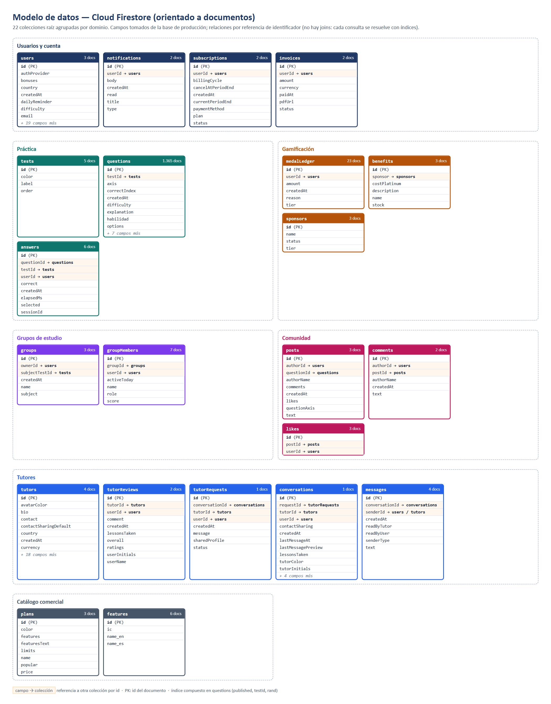

# Modelo de datos

La API persiste sus datos en **Cloud Firestore** en modo nativo (base `(default)` del
proyecto `aprueba-app-ad401`, región `southamerica-west1`). El modelo sigue la
especificación de la empresa (`Aprueba_Modelo_Datos_Firestore.docx`), con los ajustes
descritos más abajo. El diagrama de clases del dominio está en
[uml/clases.md](uml/clases.md).



## Decisiones de diseño

| Decisión | Motivo |
|---|---|
| **Colecciones raíz con referencia al padre** (por ejemplo, `answers.userId`, `groupMembers.groupId`) en lugar de subcolecciones | Permite consultar entre padres (todas las respuestas de una pregunta, todos los grupos de un alumno) con un solo índice, y mantiene una sola API de acceso (`data/repo.js`) para el driver en memoria y el de Firestore |
| **Sin joins**: cada pantalla se resuelve con consultas por campo y documentos que guardan los datos que se muestran (por ejemplo, `posts.authorName`) | Firestore no tiene joins; desnormalizar evita lecturas adicionales por elemento de una lista |
| **Cuota y medallas embebidas en `users`** (`quota`, `medals`, `bonuses`) | Se leen en cada solicitud del alumno; embeberlas evita una lectura extra |
| **`questions.rand`**, número aleatorio fijo asignado al importar | Elegir una pregunta al azar con el índice (published, testId, rand) leyendo como máximo 20 documentos, en vez de las 1.365 preguntas del banco |
| **Identificadores deterministas** en `questions` y `answers` | Reimportar el banco no duplica preguntas, y una misma respuesta no puede registrarse dos veces (creación atómica) |
| **Sin acceso directo desde clientes** | Las reglas niegan toda lectura y escritura: solo la API accede, con el Admin SDK |

## Colecciones

Cantidad de documentos en producción al 23-10-2026.

| Dominio | Colección | Documentos | Contenido | Referencias |
|---|---|---|---|---|
| Usuarios | `users` | 3 | Perfil, plan, estado, preferencias, cuota y billetera de medallas | — |
| | `notifications` | 2 | Avisos al alumno | `userId` |
| | `subscriptions` | 2 | Suscripción a un plan de pago | `userId` |
| | `invoices` | 2 | Boletas de las suscripciones | `userId` |
| Práctica | `tests` | 5 | Pruebas PAES (Comp. Lectora, Matemática M1...) | — |
| | `questions` | 1.365 | Enunciado, alternativas, respuesta correcta, explicación y eje | `testId` |
| | `answers` | 6 | Respuesta del alumno, si fue correcta y el tiempo usado | `userId`, `questionId`, `testId` |
| Gamificación | `medalLedger` | 23 | Movimientos de medallas (ganadas, canjeadas, regaladas) | `userId` |
| | `benefits` | 3 | Beneficios canjeables por medallas de platino | `sponsor` |
| | `sponsors` | 3 | Marcas que financian los beneficios | — |
| Grupos | `groups` | 3 | Grupos de estudio | `ownerId`, `subjectTestId` |
| | `groupMembers` | 7 | Miembros, rol y puntaje | `groupId`, `userId` |
| Comunidad | `posts` | 3 | Publicaciones, opcionalmente con una pregunta | `authorId`, `questionId` |
| | `comments` | 2 | Comentarios de una publicación | `postId`, `authorId` |
| | `likes` | 3 | "Me gusta" de una publicación | `postId`, `userId` |
| Tutores | `tutors` | 4 | Perfil, asignaturas, precio y valoración | — |
| | `tutorReviews` | 2 | Reseñas de alumnos | `tutorId`, `userId` |
| | `tutorRequests` | 1 | Solicitudes de contacto | `tutorId`, `userId`, `conversationId` |
| | `conversations` | 1 | Chat alumno-tutor | `userId`, `tutorId`, `requestId` |
| | `messages` | 4 | Mensajes del chat | `conversationId`, `senderId` |
| Catálogo | `plans` | 3 | Planes de pago y sus límites | — |
| | `features` | 6 | Características que se muestran en los planes | — |

El código define además colecciones que se crean con el uso (por ejemplo,
`corrections`, `groupInvitations`, `devices`, `benefitRedemptions`); no aparecen en la
tabla porque aún no tienen documentos en producción.

## Índices

| Colección | Campos | Consulta que atiende |
|---|---|---|
| `questions` | `published` ↑, `testId` ↑, `rand` ↑ | `GET /practice/next`: preguntas publicadas de una prueba a partir de un pivote aleatorio |

Las demás consultas filtran por un solo campo o por igualdad, y Firestore las resuelve
con sus índices automáticos. El índice está definido en
`aprueba/aprueba_student_web/backend/firestore.indexes.json` y se publica con
`firebase deploy --only firestore`.

## Reglas de seguridad

```
match /{document=**} {
  allow read, write: if false;
}
```

Los clientes nunca leen la base directamente; la API usa el Admin SDK, que no pasa por
las reglas.

## Pendientes

- Actualizar la cuota y los contadores del usuario con `FieldValue.increment` o
  transacciones, como indica la sección 7 del documento de la empresa: hoy se reescribe
  el documento completo y dos solicitudes simultáneas pueden pisarse (PB-15).
- Ver el detalle en [seguridad-pendiente.md](seguridad-pendiente.md), sección "Otros
  hallazgos".
