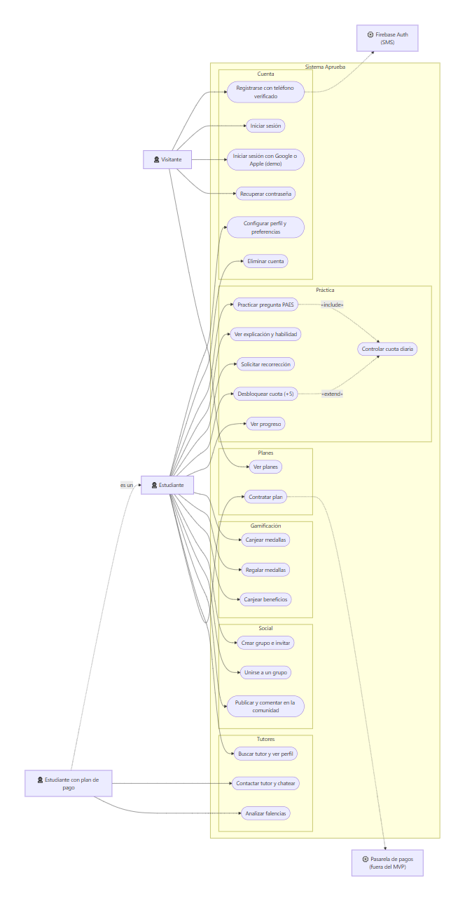
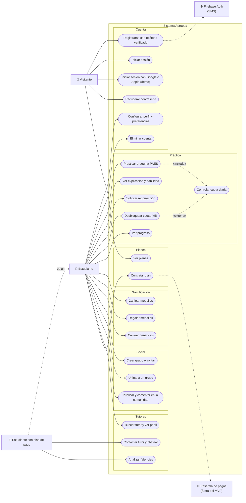

# Diagrama de casos de uso

Actores y casos de uso del sistema del estudiante (sitio web y app móvil, a través de
la API). Mermaid no tiene notación nativa de casos de uso: los actores se dibujan como
nodos rectangulares y los casos de uso como óvalos dentro del límite del sistema.

## Notas

- **Estudiante con plan de pago** hereda todos los casos del estudiante y agrega los
  marcados como premium (`403 PLAN_REQUIRED` en el plan gratuito).
- **Practicar pregunta** incluye el control de la cuota diaria: 10 preguntas base,
  +5 por colegio y +5 por dirección, con un máximo de 20; los planes de pago no tienen
  límite.
- **Iniciar sesión con Google o Apple** y **Contratar plan** solo funcionan en modo de
  demostración (`DEMO_MODE`) mientras la empresa no defina los proveedores reales.
- La consola de administración y el generador de preguntas están fuera del alcance.
