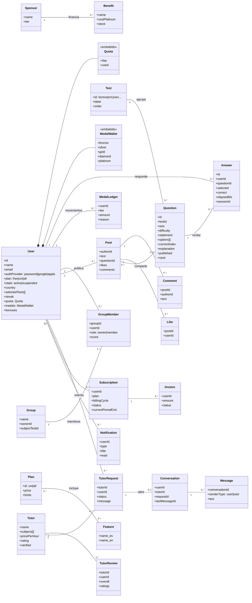

# Diagrama de clases (modelo de dominio)

Entidades del dominio y sus relaciones. Cada clase corresponde a una colección de
Cloud Firestore; las relaciones se implementan como referencias por identificador
(por ejemplo, `Answer.userId`). Ver también el [modelo de datos](../modelo-datos.md).

## Notas

- `Quota` y `MedalWallet` no son colecciones: son objetos embebidos en el documento del
  usuario.
- `Answer` usa un identificador determinista derivado de (alumno, pregunta, sesión), lo
  que impide registrar dos veces la misma respuesta.
- `Question.rand` es un número aleatorio fijo asignado al importar el banco; permite
  elegir preguntas al azar con el índice (published, testId, rand) sin leer la
  colección completa.
