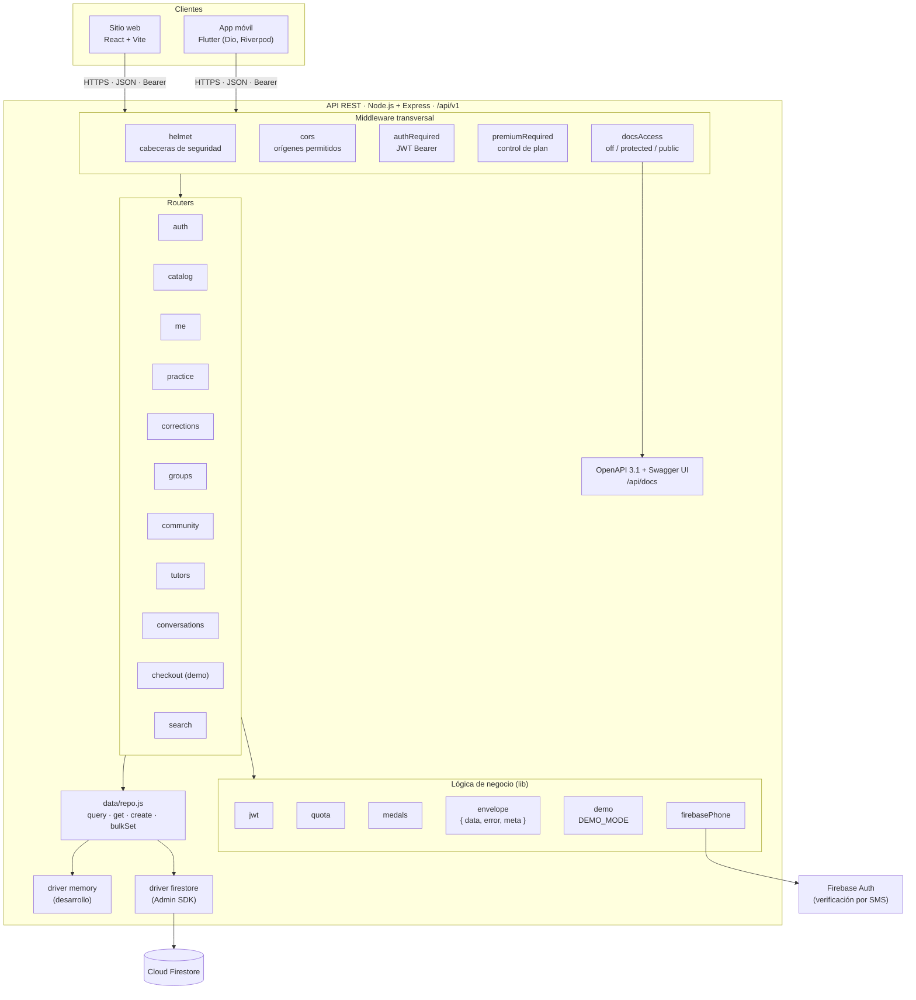

# Diagrama de componentes

Organización interna de la API y su relación con los clientes y los servicios
externos. Las rutas se agrupan en routers de Express; todas usan la misma capa de
acceso a datos (`data/repo.js`), que elige el driver según `DATA_DRIVER`.

## Responsabilidades

| Componente | Responsabilidad |
|---|---|
| Routers | Validan la solicitud y aplican las reglas de cada dominio (práctica, grupos, comunidad, tutores...) |
| `authRequired` | Verifica el token de acceso y rechaza cuentas suspendidas |
| `premiumRequired` | Responde `403 PLAN_REQUIRED` a las funciones de pago en el plan gratuito |
| `quota`, `medals` | Reglas de la cuota diaria y de la billetera de medallas |
| `envelope` | Formato común de respuesta `{ data, error, meta }` |
| `demo` | Habilita atajos de prueba solo con `DEMO_MODE=true` |
| `data/repo.js` | Única puerta a los datos; aísla las rutas del motor de base de datos |
