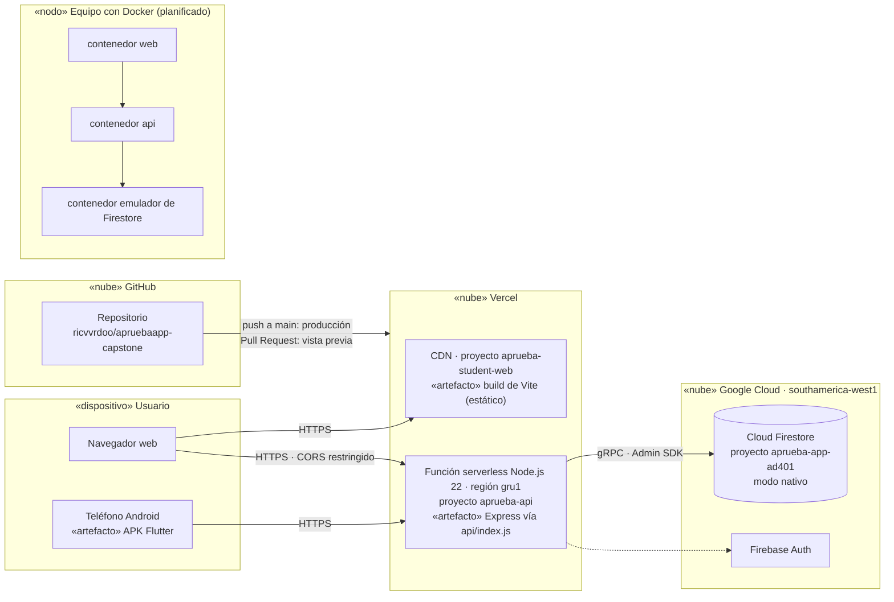

# Diagrama de despliegue

Dónde se ejecuta cada componente. La publicación continua en Vercel está operativa; el
entorno en contenedores Docker es el entregable final y está planificado para el
Sprint 5 (PB-21 del [Product Backlog](../scrum/product-backlog.md)).

## Entornos

| Entorno | Dónde | Datos | Uso |
|---|---|---|---|
| Producción | Vercel (`aprueba-api`, `aprueba-student-web`) | Firestore `aprueba-app-ad401` | Demostración a la empresa y a la institución |
| Vista previa | Vercel, una URL por Pull Request (protegida) | La misma base de Firestore, con un `JWT_SECRET` propio | Verificar cada cambio antes de integrarlo |
| Local | Equipo del desarrollador | Memoria o emulador de Firestore | Desarrollo y prueba automatizada |
| Contenedores (planificado) | Docker Compose | Emulador de Firestore | Entregable final y demostración sin conexión |
