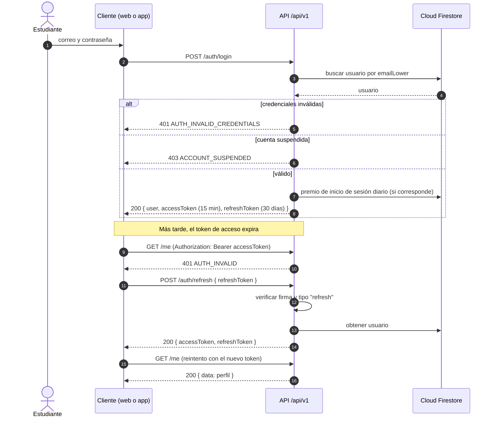
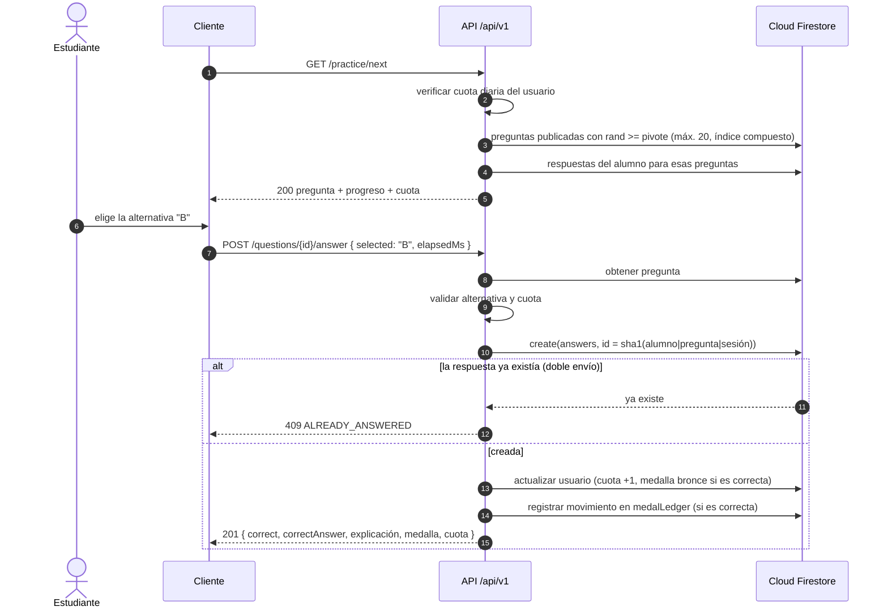
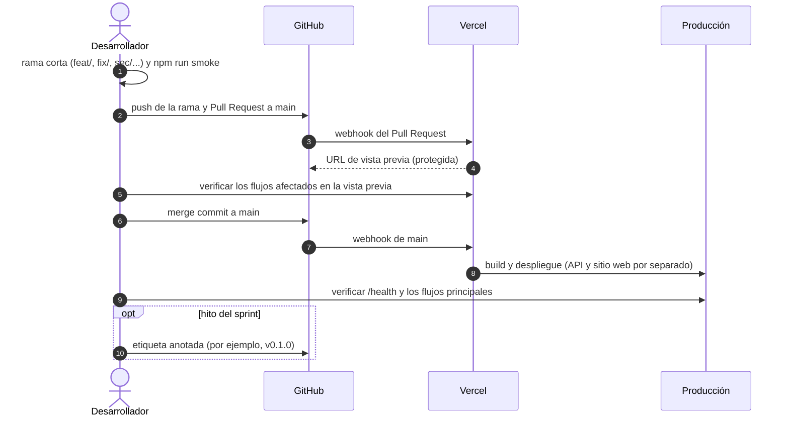

# Diagramas de secuencia

Tres flujos clave del sistema, tal como están implementados en la rama `main`.

## 1. Inicio de sesión y renovación de la sesión

El token de acceso dura 15 minutos y el de renovación, 30 días. Los clientes renuevan
de forma transparente cuando reciben un `401`.

## 2. Responder una pregunta

La respuesta se registra primero y de forma atómica: solo la solicitud que logra
crearla descuenta cuota y entrega la medalla. Así, un doble clic no duplica nada.

## 3. Despliegue continuo

Cada cambio entra por un Pull Request; Vercel publica una vista previa y, al integrarse
a `main`, despliega a producción.

